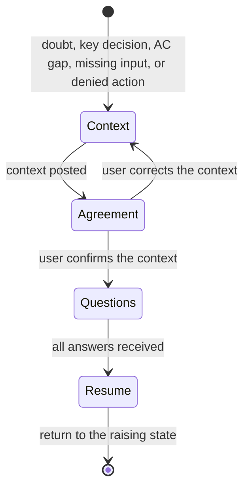

# Delegated work

Work on a ticket is split into roles. Each role starts from the artifacts that
already exist, runs its state machine, writes one output artifact, and ends
the turn. Any session may run any role on any item at any stage: one phase on
several items, one item end to end, or a later session picking up what an
earlier one left. Review and QA run in the `reviewer` and `qa` agents, which
see only the ticket, the diff or build, and what the caller passes them.

The diagrams and tables are the rules. The text only explains them.

## Roles and artifacts

The chart shows where each artifact usually goes next. It is not an order of
entry: a role starts from its minimum input below, whatever came before.

| Role | Skill | Agent | Starts from | Output | Never |
| --- | --- | --- | --- | --- | --- |
| PM | `role-pm` | `pm` | a request | ticket | builds; marks work done |
| Architect | `role-architect` | `architect` | a ticket | design note | changes AC |
| Developer | `role-developer` | `developer` | a ticket or user instruction (+ design note, review or QA report if present) | review package | edits, relaxes, or reinterprets AC |
| Reviewer | `role-reviewer` | `reviewer` | the ticket's AC and a diff (branch, PR, worktree), as it stands | review report | fixes |
| QA | `role-qa` | `qa` | the ticket's AC and a running instance | QA report | fixes; edits data to pass a case |
| Release | `role-release` | `release` | the user's acceptance | release receipt | deploys from a worktree; publishes without approval |
| Ops | `role-ops` | `ops` | an accepted change needing infrastructure | run receipt | runs Terraform or OpenTofu locally |

Artifact templates live in `templates/`. A new role is added from
`templates/role.md`, with an agent in `~/.dotfiles/ai/agents/`.

## Routing a request

Pick the role from what was asked, not from the item's status. Each role runs
in its agent (the Agent tool with that `subagent_type`), which has the role's
skills preloaded. Items in one request run in parallel, one agent per item.
The `reviewer` and `qa` agents cannot write files: they return their report
as their final message, and the caller saves it under `.scratch/<key>/`.

| Request | Roles, in order |
| --- | --- |
| review X | Reviewer |
| review and fix / adjust / redesign X | Reviewer, then Developer on the review report and the user's notes |
| implement / build / fix X | Developer, then Reviewer |
| test / QA X | QA |
| commit / land / open the PR / ship X | Release |
| plan / capture / ticket / sprint | PM |
| X needs structural decisions | Architect, before Developer |

When a request also carries the user's own notes (design feedback, a
functional change), those notes are user instructions for the Developer, with
the same standing as AC lines.

A missing upstream artifact never stops a role. The role builds what it needs
from its minimum input (the Reviewer maps hunks to AC from the diff itself) and
states on the first line of its artifact what it started from, for example
"No review package; reviewed `develop..HEAD` as found, work in progress."
Unfinished AC are judged `missing`, not waited for.

## Item state

Artifacts live in the item's folder (`.scratch/<key>/` unless the tracker doc
says otherwise). A role reads the folder to see what exists and writes the next
status to `.scratch/<key>/status` on handoff. The status records where the item
is; it never decides which role may start.

| Status | Written by |
| --- | --- |
| `ready-for-dev` | PM or stakeholders; Reviewer or QA on fail |
| `ready-for-review` | Developer |
| `ready-for-qa` | Reviewer on pass |
| `ready-for-acceptance` | QA on pass |
| `ready-for-release` | user |

Several agents or models may run the same role on one item. Each writes its own
artifact, suffixed with its model (`review-report.fable.md`), and none
overwrites another's. The workspace tracker doc maps statuses to the tracker's
states or labels.

## Plan mode

Review and QA need no plan mode. Their agents cannot write files and run with
`permissionMode: default`, so a plan-mode session can start them and put the
returned reports in the plan file. For a Developer in plan mode, the plan file
is the traceability gate: every planned change cites its AC line or user
instruction and names the agent that will run each role after approval. That
turn is ready for review when the plan is written and `ExitPlanMode` is called.

## Ending a turn

A turn ends in exactly one of two states:

| State | Guard |
| --- | --- |
| **Ready for review** | the role's output artifact is written (for `reviewer` and `qa`, returned and saved by the caller), every guard on its exit transition holds, and the review target is live (below) |
| **Unable to continue** | the interrupt below reached `Questions` |

### Review target

Work handed to the user for review or acceptance must be open in front of them
when the turn ends. The handoff never asks the user to build, start, deploy, or
find anything.

- Start the review instance yourself (dev server, preview build, or the
  workspace's review environment per its tracker doc), leave it running, and
  confirm it responds (for example `curl` returns 200) as the last check of the
  turn.
- Open it for the user (browser tab or the harness's open action) and put its
  exact URL on the first line of the handoff and the review package.
- Name what it is not: if production or another instance the user normally
  uses does not have the change, say so in that same first line.
- Evidence comes from that same running instance, not from an earlier or
  stopped one.
- A stopped server, an unstated port, or "run X to see it" is not ready for
  review.

Any other resting state is a protocol violation: no progress reports, no status
prose, no "done", "finished", "complete", or "mostly" about the work, no
caveats. A caveat is either an unmet guard (not ready) or a question (unable to
continue). Done means QA passed and the stakeholders accepted; no role declares
it.

## Interrupt: unable to continue

Any role enters it from any state.

- **Context**: what the role was doing, where it stopped, what it tried. Facts
  with locations. Leave out internals already delegated.
- **Agreement**: ask whether the context is right. Skip only for a single
  approval with no options, such as a permission.
- **Questions**: follow `grilling` — the whole frontier in one round, a
  recommended answer for each, facts are the agent's job, decisions are the
  user's. Ask with the harness question tool, never as prose that imitates it.
  Each question carries why it is asked, where its options came from, the cost
  of each option, and what the answer changes.

Tool, environment, and implementation failures belong to the role: diagnose
and fix them. They enter the interrupt only when they end in a real permission
denial, quoted with the exact command and error. Run single documented
commands; a wrapper script or a sandbox-bypass flag is never a workaround.

A key decision is one where a wrong guess changes what the stakeholders get:
scope, user-facing behavior, data, or anything hard to reverse. Routine
implementation choices that follow project conventions are not key decisions.

## Scope contract

The ticket and its AC belong to the stakeholders (the PM role where the user
owns the work). No other role, and not the user acting in another role, may
add to, relax, tighten, reinterpret, or rewrite them.

- **Out of scope**: anything not traceable to an AC line or an explicit user
  instruction, including defaults, automatic selection, restrictions, filters,
  fallbacks, empty-state semantics, new roles or permissions, endpoints,
  migrations, and UI controls.
- **AC gap or ambiguity**: enter the interrupt; quote the line; ask the AC owner.
- **Traceability gate**: every planned change cites its source before it is
  built (Developer, `Plan`).
- **Scope audit**: every diff hunk maps to a source before handoff (Developer,
  `Verify`) and again at review (Reviewer, `Check`).
- **Data and fixtures** are never changed to make unrequested behavior work.
- **Found scope creep** is removed, not defended or explained.
- **Summaries, relays, and handoffs** state the rule as the contract ("out of
  scope per AC"), never as what the user insists on or prefers.

## Workspace configuration

Read the workspace's tracker doc (linked from its AGENTS.md "Agent skills"
block) before taking a role. It states the tracker, the roles the agent may
take, the AC owner, the item-state mapping, the permitted writes, and the release
target. A role the workspace does not allow is not taken; its artifact comes
from the stakeholders.

## Handoffs

- Between roles: the output artifact, stored where the tracker doc says.
- Between agents or harnesses mid-role: `/handoff`.
