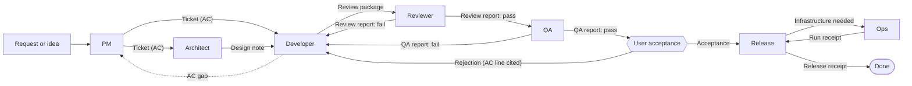
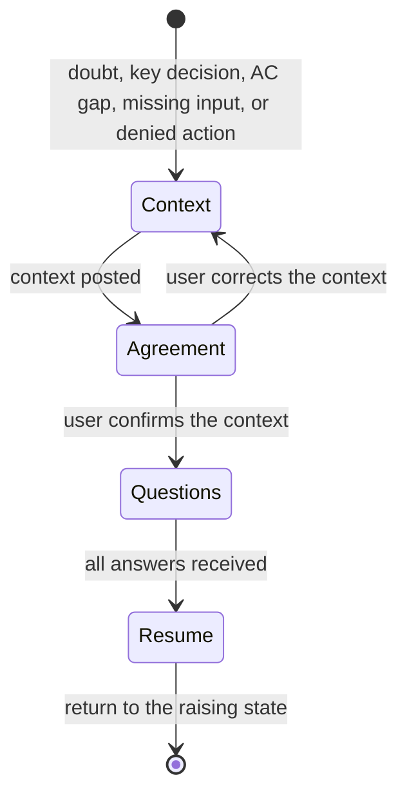

# Delegated work

Delegated work is split into roles. Each role reads one input artifact, runs
its state machine, writes one output artifact, and hands off. Roles never share
a conversation; each runs in its own context (fresh session, subagent, or
`/handoff`, per Matt Pocock's `PHASE-BOUNDARIES.md`).

The diagrams and tables are the rules. The text only explains them.

## Roles and artifacts

| Role | Skill | Input | Output | Never |
| --- | --- | --- | --- | --- |
| PM | `role-pm` | request | ticket | builds; marks work done |
| Architect | `role-architect` | ticket needing structural decisions | design note | changes AC |
| Developer | `role-developer` | ticket (+ design note) | review package | edits, relaxes, or reinterprets AC |
| Reviewer | `role-reviewer` | ticket + review package + diff | review report | fixes |
| QA | `role-qa` | ticket + passing review report | QA report | fixes; edits data to pass a case |
| Release | `role-release` | acceptance | release receipt | deploys from a worktree; publishes without approval |
| Ops | `role-ops` | accepted change needing infrastructure | run receipt | runs Terraform or OpenTofu locally |

Artifact templates live in `templates/`. A new role is added from
`templates/role.md`.

## Queues

Every artifact carries a status. Each role pulls a batch from the queue in
front of it and sets the next status on handoff.

| Status | Set by | Pulled by |
| --- | --- | --- |
| `ready-for-dev` | PM or stakeholders | Developer (or Architect first) |
| `ready-for-review` | Developer | Reviewer |
| `ready-for-qa` | Reviewer | QA |
| `ready-for-acceptance` | QA | user |
| `ready-for-release` | user | Release |

The workspace tracker doc maps these statuses to the tracker's states or labels.

## Ending a turn

A turn ends in exactly one of two states:

| State | Guard |
| --- | --- |
| **Ready for review** | the role's output artifact is written and every guard on its exit transition holds |
| **Unable to continue** | the interrupt below reached `Questions` |

Any other resting state is a protocol violation: no progress reports, no status
prose, no "done", "finished", "complete", or "mostly" about the work, no
caveats. A caveat is either an unmet guard (not ready) or a question (unable to
continue). Done means QA passed and the stakeholders accepted; no role declares
it.

## Interrupt: unable to continue

Any role enters it from any state.

- **Context**: what the role was doing, where it stopped, what it tried. Facts
  with locations. Leave out internals already delegated.
- **Agreement**: ask whether the context is right. Skip only for a single
  approval with no options, such as a permission.
- **Questions**: follow `grilling` — the whole frontier in one round, a
  recommended answer for each, facts are the agent's job, decisions are the
  user's. Ask with the harness question tool, never as prose that imitates it.
  Each question carries why it is asked, where its options came from, the cost
  of each option, and what the answer changes.

Tool, environment, and implementation failures belong to the role: diagnose
and fix them. They enter the interrupt only when they end in a real permission
denial, quoted with the exact command and error. Run single documented
commands; a wrapper script or a sandbox-bypass flag is never a workaround.

A key decision is one where a wrong guess changes what the stakeholders get:
scope, user-facing behavior, data, or anything hard to reverse. Routine
implementation choices that follow project conventions are not key decisions.

## Scope contract

The ticket and its AC belong to the stakeholders (the PM role where the user
owns the work). No other role, and not the user acting in another role, may
add to, relax, tighten, reinterpret, or rewrite them.

- **Out of scope**: anything not traceable to an AC line or an explicit user
  instruction, including defaults, automatic selection, restrictions, filters,
  fallbacks, empty-state semantics, new roles or permissions, endpoints,
  migrations, and UI controls.
- **AC gap or ambiguity**: enter the interrupt; quote the line; ask the AC owner.
- **Traceability gate**: every planned change cites its source before it is
  built (Developer, `Plan`).
- **Scope audit**: every diff hunk maps to a source before handoff (Developer,
  `Verify`) and again at review (Reviewer, `Check`).
- **Data and fixtures** are never changed to make unrequested behavior work.
- **Found scope creep** is removed, not defended or explained.
- **Summaries, relays, and handoffs** state the rule as the contract ("out of
  scope per AC"), never as what the user insists on or prefers.

## Workspace configuration

Read the workspace's tracker doc (linked from its AGENTS.md "Agent skills"
block) before taking a role. It states the tracker, the roles the agent may
take, the AC owner, the queue mapping, the permitted writes, and the release
target. A role the workspace does not allow is not taken; its artifact comes
from the stakeholders.

## Handoffs

- Between roles: the output artifact, stored where the tracker doc says.
- Between agents or harnesses mid-role: `/handoff`.
