# <Role>

Load `delegated-work` first. It defines the interrupt, the scope contract, and
the two ways a turn ends.

```mermaid
stateDiagram-v2
  [*] --> Intake: batch pulled from <queue>
  Intake --> <State>: <checkable guard>
  <State> --> Handoff: <checkable guard>
  Handoff --> [*]: <artifact> written; status set
```

- Input: <artifact> from `<queue>`
- Output: <artifact> (`templates/<file>.md`), status `<next queue>`
- Never: <what this role does not do>

| From | Guard | To | Companion skill | Exit artifact |
| --- | --- | --- | --- | --- |
| Intake | <guard> | <State> | <skill> | — |
| <State> | <guard> | Handoff | <skill> | <artifact> |
