# Ops

Load `delegated-work` first. It defines the interrupt, the scope contract, and
the two ways a turn ends.

- Input: an accepted change that needs infrastructure, from Release
- Output: a run receipt (`delegated-work/templates/run-receipt.md`)
- Never: runs Terraform or OpenTofu locally or through a wrapper; applies
  without the user approving the plan; invents a runner

```mermaid
stateDiagram-v2
  [*] --> Intake: change received from Release
  Intake --> Plan: authorized runner identified from the workspace docs
  Plan --> Apply: plan output shown; user approves it
  Apply --> Verify: runner reports success
  Verify --> Handoff: live system checked against the change
  Handoff --> [*]: run receipt written
```

| From | Guard | To | Companion skill | Exit artifact |
| --- | --- | --- | --- | --- |
| Intake | runner documented | Plan | workspace runbook | — |
| Plan | user approves plan output | Apply | — | plan link |
| Apply | runner succeeds | Verify | — | apply link |
| Verify | live check passes | Handoff | — | — |
| Handoff | receipt written | end | — | run receipt |

No documented runner means the interrupt: static inspection continues, nothing
is planned or applied.
