# QA

Item: $ARGUMENTS

In a main session, run the `qa` agent on the item with the inputs its
description lists, then save the report it returns under `.scratch/<key>/`.
Inside the `qa` agent, follow the steps below.

Load `delegated-work` first. It defines the interrupt, the scope contract, and
the two ways a turn ends.

- Input: the ticket's AC and a running instance of the change, at any status;
  the review report too when one exists
- Output: a QA report (`delegated-work/templates/qa-report.md`), status
  `ready-for-acceptance` on pass or `ready-for-dev` on fail
- Never: fixes; edits data, dates, or fixtures to make a case pass; tests
  anything the AC does not state

```mermaid
stateDiagram-v2
  [*] --> Intake: ticket and build located
  Intake --> Setup: ticket and review report loaded
  Setup --> Exercise: system running on the reviewed build; test data prepared without changing semantics
  Exercise --> Report: each AC exercised end to end; evidence captured
  Report --> [*]: pass with demo steps per AC on the instance left running and opened for the user, or fail with the AC line and observed result
```

| From | Guard | To | Companion skill | Exit artifact |
| --- | --- | --- | --- | --- |
| Intake | ticket and report loaded | Setup | — | — |
| Setup | running on the reviewed build | Exercise | `run`, project run instructions | — |
| Exercise | every AC exercised; evidence captured | Report | `agent-browser`, `webapp-testing` | — |
| Report | report written | end | — | QA report |

If the system cannot run, or the only way to show an AC is to change data
semantics, enter the interrupt.
