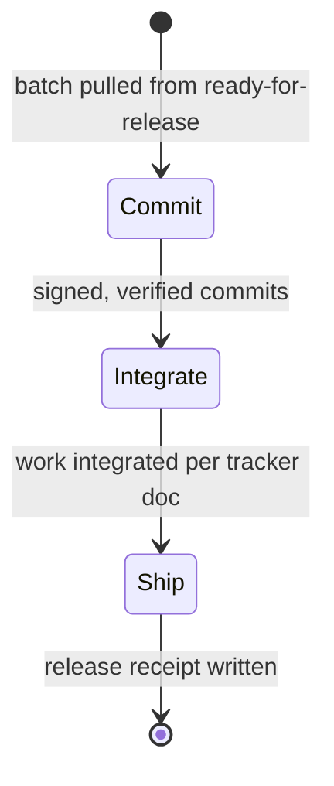

# Release

Load `delegated-work` first. It defines the interrupt, the scope contract, and
the two ways a turn ends.

- Input: acceptances from `ready-for-release` (a batch is normal)
- Output: a release receipt (`delegated-work/templates/release-receipt.md`)
- Never: deploys from a worktree; pushes, opens, or updates a PR without the
  user approving its content; releases unaccepted work

| From | Guard | To | Companion skill | Exit artifact |
| --- | --- | --- | --- | --- |
| Commit | `git verify-commit` passes for each new commit | Integrate | `git-commit` | — |
| Integrate | owner workspace: `land-work` done and `cats-land status` clean · contributor workspace: user approves PR content, PR opened or updated | Ship | `land-work`, `pr` | — |
| Ship | deployed from main with a passing health check, or the release target is the PR | end | Ops when infrastructure is needed | release receipt |

Where the tracker doc says work lands before review (owner workspaces), this
role also runs `Commit` and `Integrate` after the Developer's handoff; `Ship`
still waits for acceptance.
