# Reviewer

Load `delegated-work` first. It defines the interrupt, the scope contract, and
the two ways a turn ends.

- Input: a review package from `ready-for-review`, its ticket, and the diff
- Output: a review report (`delegated-work/templates/review-report.md`), status
  `ready-for-qa` on pass or `ready-for-dev` on fail
- Never: fixes, rewrites, or reruns the Developer's work; reads the Developer's
  conversation

```mermaid
stateDiagram-v2
  [*] --> Read: package pulled from ready-for-review
  Read --> Check: ticket AC, source map, and diff loaded
  Check --> Report: every AC judged; every hunk mapped to a source
  Report --> [*]: pass (all AC met, no unsourced behavior) or fail (lines cited)
```

| From | Guard | To | Companion skill | Exit artifact |
| --- | --- | --- | --- | --- |
| Read | ticket, package, diff loaded | Check | — | — |
| Check | each AC judged met / missing / partial / wrong; each hunk sourced or flagged | Report | `code-review` | — |
| Report | report written | end | — | review report |

Pass requires every AC met and no unsourced behavior. Anything else fails, with
the AC line quoted and the file and line cited.
